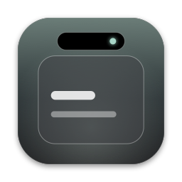
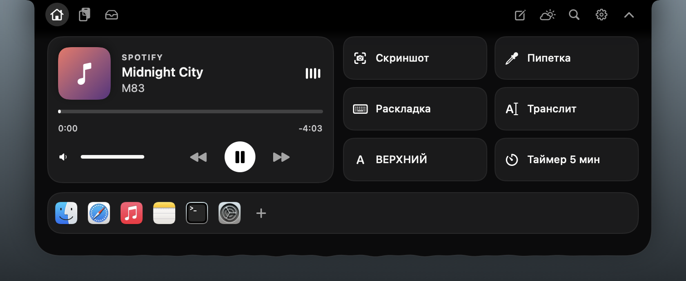
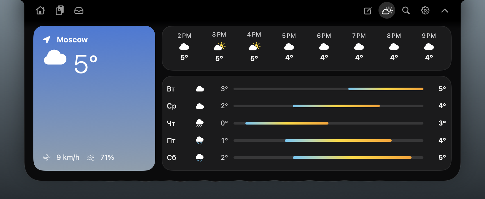
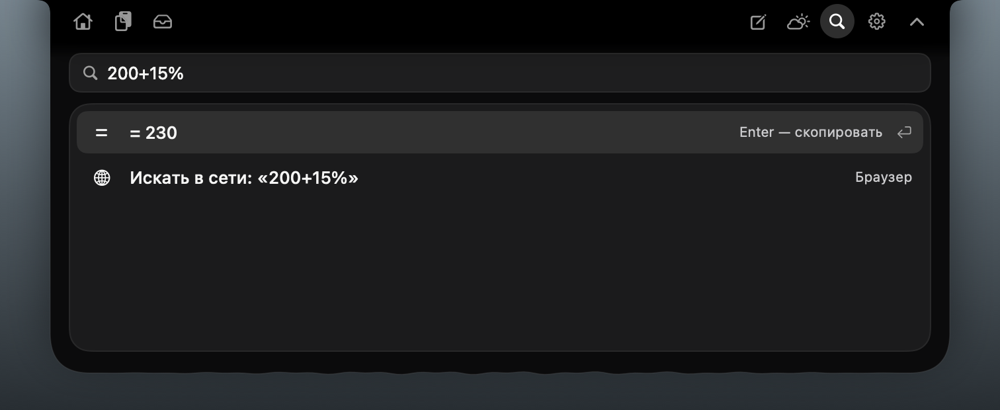

<p align="center">
  
</p>

<h1 align="center">Islet</h1>

<p align="center">
  A Dynamic Island for the Mac. It grows out of the notch: music, clipboard history,<br>
  a file shelf, notes &amp; timer, weather and a command bar, all with soft spring animations.<br>
  <b>Free and open source · MIT · made by juni0rov</b>
</p>

<p align="center">
  <a href="../../releases/latest"><b>⬇︎ Download the latest release</b></a>
</p>

<p align="center">
  <br>
  
</p>

---

## What it does

| | |
|---|---|
| **Grows out of the notch** | On a MacBook with a notch the island is a black pill that starts at the very top edge and wraps around the camera. Small "wings" on either side show the time, the weather and a little cat. On displays without a notch it floats as a glass capsule. |
| **Hover → open, click → pin** | Hover over the island and it opens with a spring animation. Move the pointer away and it closes. A click pins it open. Esc, the ⌃ button or a click anywhere else closes it. |
| **Now Playing** | Spotify and Apple Music: artwork, progress you can drag, volume, and previous / play-pause / next. While music plays, the bottom edge of the island ripples and the bars in the wing move. |
| **Live activities** | Small pop-ups grow out of the island: *Copied*, *Put on the shelf*, new song, timer finished, colour picked. |
| **Clipboard history** | Everything you copy, with search, pin and delete. Click an entry to copy it back. Items that password managers mark as concealed or transient are skipped. |
| **Shelf** | Drag files onto the island to keep them there, then drag them out wherever you need them. |
| **Quick actions** | Screenshot, colour picker (copies the HEX code), fix keyboard layout (`ghbdtn` → `привет`), transliterate, UPPERCASE, 5-minute timer. |
| **App dock** | Your favourite apps, one click away. Add or remove them as you like. |
| **Notes & timer** | A notepad that keeps its text, plus a timer with a progress ring and presets. |
| **Weather** | Now, the next hours and the week, from Open-Meteo. No API key and no location permission: only the city name you set is sent. |
| **Command bar ⌥Space** | One line for everything: open apps, do maths (`2400*15%`), start a timer (`timer 10`, `таймер 10`) or search the web. |
| **Character** | A cat in the left wing follows your cursor, blinks, bobs to music and falls asleep when you're away. |
| **Themes** | *Obsidian* (black, the default), *Pearl* and *Adaptive*, which takes its colour from album artwork or your wallpaper. All text keeps a contrast of at least 4.5:1. |
| **Accessibility** | Supports Reduce Motion (no springs or ripples), Reduce Transparency and Increase Contrast. Every control has a VoiceOver label. **⌃⌥Space** opens the island from the keyboard. |
| **Languages** | English and Русский. Switching applies right away, with no relaunch. |

<p align="center">
  <br>
   
</p>

## Install

1. Download `Islet-x.y.z.zip` from [Releases](../../releases/latest) and unzip it.
2. Move **Islet.app** to `/Applications`.
3. Open it. On first launch you will see a short splash screen, and a capsule icon appears in the menu bar.

**Requirements:** macOS 14 Sonoma or later. Universal build for Apple silicon and Intel.

### Gatekeeper (please read)

Releases are **ad-hoc signed** and **not notarized** by Apple, because that requires a paid Apple Developer membership. Here is what macOS does with such an app after you download it in a browser:

- **macOS 15 Sequoia and later:** the first launch is blocked with *“Islet” Not Opened*. Click **Done**, then open **System Settings → Privacy & Security**, scroll down to the message about Islet and click **Open Anyway**, then confirm. You only need to do this once.
- **macOS 14 Sonoma:** Control-click (right-click) **Islet.app → Open**, then click **Open** in the dialog.

Please don't turn off Gatekeeper globally. If you'd rather not run an unnotarized binary, build Islet from source with the steps below. It takes about a minute.

> These steps follow Apple's documented behaviour for apps that are not notarized. The maintainer tested the release on a Mac where it was built, which does not show the quarantine prompt. If you see something different, please open an issue.

## Usage

| Action | How |
|---|---|
| Open | Hover over the island (the delay can be changed in Settings) |
| Pin open | Click the island |
| Close | Esc, the ⌃ button, or a click anywhere else |
| Keyboard entry | **⌃⌥Space** (or the menu bar icon → *Expand Island*) |
| Command bar | **⌥Space** |
| Add to shelf | Drag files onto the island |
| Settings | ⚙︎ in the island, or the menu bar icon → *Settings…* |

**Permissions.** The island itself asks for nothing. The only system prompt you may see is *"Islet wants to control Spotify / Music"*, the first time Islet reads artwork or you press a playback button. That is macOS Automation, used only for the player app. Track titles come from public notifications and work even if you decline.

**Not on macOS.** Some features from Windows "islands" can't be built on macOS with public APIs. These include notifications from other apps, Wi-Fi and Bluetooth toggles, and global screen recording. Islet leaves them out instead of using private APIs.

## Build from source

You don't need a paid Apple account. Either **Xcode 16+** or the **Command Line Tools** works.

```bash
git clone https://github.com/juni0rov/Islet.git
cd Islet
./scripts/build-app.sh          # → dist/Islet.app and dist/Islet-<version>.zip
./scripts/test.sh               # unit tests (Swift Testing)
```

With a working SwiftPM you can also use `swift build`, `swift test` or `open Package.swift` in Xcode. `xcodebuild -scheme Islet -destination 'platform=macOS' build test` works too.

> Some Command Line Tools 16.x installs ship a duplicate `SwiftBridging` module map. When that happens, every `import Foundation` fails with *“redefinition of module 'SwiftBridging'”*. Both scripts detect this and work around it with a compiler VFS overlay. Your system files are not changed.

Developer switches (environment variables):

| Variable | Effect |
|---|---|
| `ISLET_GEOMETRY=1` | Print screen snapshots, notch classification and placements |
| `ISLET_SNAPSHOT=<dir>` | Render splash, island states and settings to PNG, then quit |
| `ISLET_PSEUDO=1` | Pseudo-localisation: strings grow by ~40% |
| `ISLET_RTL=1` | Force right-to-left layout |
| `ISLET_OPAQUE=1` | Simulate Reduce Transparency |

## Project layout

```
Sources/Islet/
  Core/      Geometry (pure placement engine), DisplayGeometryProvider, Theme tokens & contrast,
             ThemeStore (Adaptive sources), Localization (xcstrings reader, plural rules),
             LanguageStore, Interaction state machine
  App/       Main, AppDelegate (menu bar, hot key), AppModel, IslandWindowCoordinator (NSPanel)
  UI/        Island views, module views, shared components, Settings, Splash
  Modules/   Media, Timer, Battery, Shelf
  Resources/ Localizable.xcstrings (en, ru)
Tests/IsletTests/  geometry, themes & contrast, language & plurals, interaction
```

## Acceptance matrix

Unit tests cover geometry (synthetic snapshots: notch, no notch, unknown, negative and vertical layouts, 1×/2×/3×, corrupted data), contrast, language resolution and fallback, Russian and Arabic plural forms, and the hover/click/Esc state machine.

| ID | Scenario | Status |
|---|---|---|
| UI-1 | Themes match tokens, switch live, persist | Unit-tested tokens; switching and persistence checked through offscreen render. Note: by design the notch band is always black so it blends into the camera housing. |
| UI-2 | Contrast 4.5:1 / 3:1; Reduce Transparency; Increase Contrast | Unit-tested on panel and glass over black and white; system toggles **not run yet** |
| UI-3 | Adaptive source changes, fallback, stale results | Logic implemented; **not run on device** |
| L-1 | System and manual language; ru applies live and persists | Unit-tested |
| L-2 | Fallback to en; ru/ar plural forms | Unit-tested |
| L-3 | +40% strings, RTL on a narrow width | Switches available (`ISLET_PSEUDO`, `ISLET_RTL`); **not run yet** |
| D-1 | Real notch: anchor within 1 px of the gap centre | Checked on a 14" MacBook Pro (macOS 15) with `ISLET_GEOMETRY=1`: gap 646–825 pt, anchor 735.5 pt, top edge = screen top (956 pt). **Design change at the owner's request:** the island grows out of the notch (it covers the band beside the camera) instead of sitting below the menu bar as addendum §06 says. |
| D-2 | Real Mac without a notch; corrupted geometry | Synthetic tests only |
| D-3 | External display: select, unplug, replug | **Not run** |
| D-4 | Scaling, arrangement, mirroring, sleep, auto-hide menu bar, Spaces | **Not run** |
| I-1 | Fast pass doesn't open; click pins; click or Esc closes | Unit-tested state machine; **not run by hand yet** |
| I-2 | Keyboard entry, VoiceOver, Reduce Motion | Implemented; **not run with VoiceOver yet** |
| B-1 | Build and tests without a paid account | ✔ Built and tested with the Command Line Tools only |

Please report any results with your macOS version, display setup, steps and outcome.

## License

MIT © juni0rov. See [LICENSE](LICENSE).
